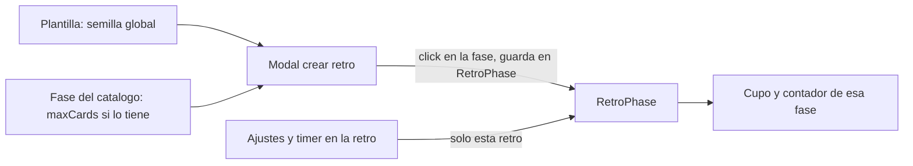

# Límites de comentarios y votos por fase

## Criterio

La retro deja de pensarse como un todo y pasa a ser un conjunto de fases. Cada fase es un mundo: su cupo, su timer y lo que se agregue después viven en su estado y no dependen de otra fase. Que votar tenga sentido solo si hay tarjetas, o que presentar las más votadas tenga sentido solo si se votó, lo decide quien arma la retro. El producto no impone esa secuencia.

Ese criterio queda en [`.cursor/rules/fase-es-un-mundo.mdc`](.cursor/rules/fase-es-un-mundo.mdc) para los desarrollos que vengan. El estado de una fase se puede compartir como resultado (el total de votos de una tarjeta suma todas las fases de votación) sin mezclar los cupos.

## Por qué hoy dice 1/2

El cupo de tarjetas solo es por fase cuando esa fase tiene `maxCardsPerParticipant`. Si está vacío, [`resolveMaxCards`](backend/src/retros/phase-rules.ts) cae al `maxCommentsPerParticipant` de toda la retro, y [`cardQuotaWhere`](backend/src/retros/retros.service.ts) cuenta **todas** las tarjetas de la persona. El tablero encima siempre muestra `myCommentCount` sin filtrar por `createdInPhaseId` (alrededor de la línea 1749). Por eso la tarjeta de Semáforo aparece en el 1/2 de Habilidades.

Los votos son igual de globales: `Vote` no tiene fase, el único es `(participantId, cardId)` y el cupo usa `retro.votesPerParticipant` / `retro.maxVotesPerCard`. "Estoy listo" también es un booleano único por persona (`commentsReady`, `votesReady`, `semaforoReady`), así que la segunda fase de tarjetas hereda el listo de la primera.

## Qué queda por fase

La fuente de verdad en una retro pasa a ser `RetroPhase`, no `Retrospective` ni la fase del catálogo. Crear la retro y guardar ajustes escriben solo el snapshot de esa retro (`RetroPhase` y el reloj en marcha de `Retrospective`). No actualizan `Phase` ni la plantilla.

- `maxCardsPerParticipant` (ya existe): solo tarjetas creadas en esa fase (`createdInPhaseId`). `null` = ilimitado en esa fase. No hay más fallback al máximo de la retro.
- `votesPerParticipant` y `maxVotesPerCard` (columnas nuevas): solo si la fase vota. Voto único guarda máx. 1 por tarjeta y no se muestra ese campo.
- `Vote.retroPhaseId`: cada voto queda en la fase en la que se emitió. El unique pasa a `(participantId, cardId, retroPhaseId)` y lo mismo para grupos.
- Listo por fase: tabla `ParticipantPhaseReady` (`participantId` + `retroPhaseId` + `ready`). Al volver a una fase anterior se recupera su listo. Semáforo, votos y comentarios usan la misma tabla.

Hay dos números distintos y no se mezclan.

- **Cupo de la fase.** "Tus votos: n / m" y el tope de votos que una persona puede poner en una tarjeta en esta fase miran solo los votos emitidos acá. Votación 1 con máximo 4 muestra 0/4, 1/4, 2/4. Votación 2 con máximo 2 muestra 0/2, 1/2, 2/2. Lo gastado en la otra fase no entra en ese contador ni impide votar de nuevo hasta el tope de esta.
- **Total de la tarjeta.** Los votos se suman entre fases. Si una tarjeta sacó 2 en Votación 1 y 1 en Votación 2, en la tarjeta se ve 3. Ese total es el que se muestra siempre: en la fase de votación, al agrupar y en las fases que presentan las más votadas (plan de acción, orden por más votadas, presentación). El ranking usa esa suma, no el recorte de la última fase. El control +/− de la fase en curso sigue mostrando cuántos puso esta persona en esta fase respecto del máximo de la fase; el badge de la tarjeta muestra la suma.

Las columnas viejas de `Retrospective` y `Template` (`maxCommentsPerParticipant`, `votesPerParticipant`, `maxVotesPerCard`) se quedan solo como semilla al crear la retro. En tiempo de juego no se leen.

## Crear la retro

En [frontend/src/app/pages/team/team.page.ts](frontend/src/app/pages/team/team.page.ts), las pastillas pasan a tener selección (el componente ya emite `select`). Al clickear una fase se abre un panel debajo, como en el editor de plantillas:

- Si permite crear tarjetas: "Máx. comentarios / persona" (vacío = ilimitado).
- Si `voting` es `single` o `multi`: "Votos por persona".
- Si `voting` es `multi`: "Máx. votos por tarjeta". Si es `single`, ese campo no aparece (queda en 1).
- Si no crea tarjetas ni vota: el panel dice que esa fase no usa estos ajustes y no muestra inputs.

Esos campos salen del bloque "Opciones". Ahí siguen anónimo y agrupar entre columnas. El "Timer por defecto" de Opciones también sale: la duración vive en la fase.

Si la fase tiene timer (`timerSeconds` distinto de vacío), el panel muestra la duración, precargada con la de la fase (las mismas opciones del editor de fases, sin "Sin timer"). Cambiarla ahí solo afecta a esta retro. Si la fase está en "Sin timer", el campo no aparece.

Al elegir plantilla o agregar una fase, el panel se precarga así: máx. de tarjetas = el de la fase, o si está vacío el de la plantilla; votos = los de la plantilla; timer = el de la fase. El `POST /retros` manda esos números en cada ítem de `phases` y se persisten en el snapshot. El hint del editor de fases ([phase-editor.page.ts](frontend/src/app/pages/phases/phase-editor.page.ts), "vacío = el de la retro") pasa a "vacío = el de la plantilla al crear la retro".

## Ajustes dentro de la retro

El modal de [retro.page.html](frontend/src/app/pages/retro/retro.page.html) titula con la fase en curso y muestra solo los campos que aplican, con la misma regla de arriba. Guardar escribe en esa `RetroPhase` (el `phaseId` queda fijado al abrir el modal). "Agrupar entre columnas" sigue siendo de la retro.

## Timer

`RetroPhase.timerSeconds` ya se copia de la fase al crear la retro. Hoy la UI ignora eso y usa el `timerSeconds` único de `Retrospective` (el selector del header y el de ajustes, en [retro.page.html](frontend/src/app/pages/retro/retro.page.html) alrededor de las líneas 94 y 310). Al cambiar de fase, [advancePhase](backend/src/retros/retros.service.ts) corta el reloj en marcha y no carga la duración de la fase nueva.

- Al entrar a una fase, la duración que se muestra es la de esa `RetroPhase`. Una fase de 10 minutos queda en 10:00, parada, lista para iniciar. No arranca sola. El reloj que venía corriendo o en pausa de la fase anterior se descarta, como ahora.
- Si `timerSeconds` de la fase es vacío, el timer no se muestra: ni los controles del facilitador ni el contador de los participantes. `startTimer` rechaza la fase.
- El modal de ajustes muestra la duración solo cuando la fase tiene timer, con las mismas opciones del editor de fases (1 a 20 minutos, sin "Sin timer"). Guardar, y también cambiar el selector del header, actualiza `RetroPhase.timerSeconds` de esta retro. La fase del catálogo no cambia. Si el reloj ya está corriendo, el cambio vale para la próxima vez que se inicie, no corta la cuenta actual.
- No se copia el timer global de retros viejas sobre fases en "Sin timer". Esas fases siguen sin timer.

El contador "Tus comentarios: n / m", `canComment` y el progreso del facilitador usan las tarjetas creadas en la fase actual. "Tus votos: n / m" usa solo el cupo de la fase en curso. El número pintado en cada tarjeta, y el orden por más votadas, usan la suma de todas las fases.

## Migración

Para retros ya creadas:

- Fase que crea tarjetas y tiene `maxCardsPerParticipant` vacío: copiar el máximo de la retro (puede seguir vacío = ilimitado).
- Fase que vota: copiar votos por persona y máx. por tarjeta de la retro; si el voto es único, máx. por tarjeta = 1.
- Votos existentes: asignarlos a la fase de votación. Si hay más de una, a la primera por posición.
- `commentsReady` / `votesReady` / `semaforoReady`: copiarlos a las fases de tarjetas, de votación y de semáforo respectivamente. En el flujo clásico hay una sola de cada tipo, así que se ve igual.

## Archivos principales

- [backend/prisma/schema.prisma](backend/prisma/schema.prisma) y una migración nueva
- [backend/src/retros/phase-rules.ts](backend/src/retros/phase-rules.ts) y el gemelo [frontend/src/app/core/phase-rules.ts](frontend/src/app/core/phase-rules.ts): `resolveMaxCards` deja de mirar la retro
- [backend/src/retros/retros.service.ts](backend/src/retros/retros.service.ts): alta de tarjeta, votos, listo, `getBoard`, `updateSettings`
- [backend/src/retros/dto/retros.dto.ts](backend/src/retros/dto/retros.dto.ts): límites dentro de cada fase al crear, y en settings
- [frontend/src/app/pages/team/team.page.ts](frontend/src/app/pages/team/team.page.ts), [frontend/src/app/pages/retro/retro.page.ts](frontend/src/app/pages/retro/retro.page.ts) y su HTML
- Modelos en [frontend/src/app/core/models/index.ts](frontend/src/app/core/models/index.ts)

Al terminar, rebuild de `web` y `api` y aviso de http://localhost:8090.